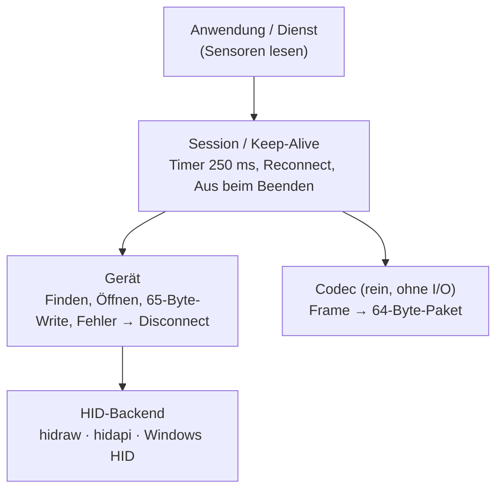

Diese Seite fasst zusammen, was eine Library zur Ansteuerung des Displays leisten muss – unabhängig von
der Programmiersprache. Die [.NET-Referenz-Implementierung](referenz-dotnet/) setzt das um.

## Schichten



| Schicht | Aufgabe | Testbarkeit |
|---|---|---|
| **Codec** | Werte → 64 Byte nach [Update-Paket](../protokoll/update-paket/), Aus-Paket | vollständig per Unit-Test mit den Testvektoren |
| **Gerät** | VID/PID-Suche, Öffnen, Report-ID voranstellen, Write mit Timeout | gegen echtes Gerät / Mock |
| **Session** | periodisch senden, aktuellen Frame atomar austauschen, Hotplug | mit Fake-Gerät |

## Anforderungen

### Erkennung

- Nur **bekannte VID/PID-Paare** ansprechen (`5131:200e`, `5131:2007`). Vendor `0x5131` wird auch für
  fremde Geräte verwendet – niemals „alle Geräte von 0x5131“ beschreiben.
- Zusätzlich prüfen: HID-Interface mit Output-Report-Länge 64 (bzw. 65 inkl. Report-ID).
- Keine Seriennummer vorhanden → Mehrfachgeräte über den physischen Pfad unterscheiden.
- Fehlende Produkt-/Herstellerstrings sind **kein Fehler**.

### Senden

- Jedes Paket **vollständig** (64 Byte) senden; über hidraw/hidapi/Windows mit Report-ID `0x00` davor (65 Byte).
- Intervall standardmäßig **250 ms**, konfigurierbar, aber **höchstens 400 ms** – das Display schaltet nach ca. 400–500 ms ohne Paket ab.
- Der Sende-Thread darf durch langsame Sensoren nicht blockiert werden: Sensoren in eigenem Takt lesen
  und den zuletzt gültigen Frame **atomar** in die Session legen.
- Pro Gerät **ein** Schreiber (Mutex o. ä.). Zwei Prozesse auf demselben Gerät führen zu Flackern.
- Uhrzeit-Felder bei jedem Paket mit der aktuellen Lokalzeit füllen.

### Fehler & Hotplug

| Situation | Verhalten |
|---|---|
| Gerät beim Start nicht vorhanden | periodisch (z. B. jede Sekunde) neu suchen oder udev-Monitor nutzen |
| Öffnen scheitert mit „Zugriff verweigert“ | klare Meldung mit Hinweis auf udev-Regel; nicht in Endlosschleife loggen |
| Write scheitert (`ENODEV`, `EPIPE`, I/O-Fehler) | Handle schließen, Zustand „getrennt“, Reconnect |
| Write-Timeout | einmal wiederholen, danach wie Fehler behandeln |
| Beenden (Dispose, `SIGTERM`, Dienst-Stopp) | Timer stoppen, **Aus-Paket** senden, Handle schließen |
| Systemsuspend | nach dem Aufwachen reconnecten (Gerät wird oft neu enumeriert) |

### API-Empfehlung

```text
Frame            – unveränderlicher Wertesatz (nullable Felder, Temperaturen immer in °C, Einheit separat)
encode_update(frame, now) -> bytes[64]
encode_off()              -> bytes[64]
enumerate()               -> [DeviceInfo]        # ohne zu öffnen (funktioniert ohne Rechte)
open(info)                -> Device
Device.send_packet(bytes[64])
Session(connect_fn, interval)
Session.update(frame)       # thread-safe
Session.start() / Session.close(send_off = true)
events: connected(path), disconnected, packet_sent(bytes)
```

### Nicht-Ziele

- Lüfter/Pumpe **regeln** (läuft über die Mainboard-Header).
- ARGB-Beleuchtung (läuft über den 5-V-ARGB-Header).
- Sensoren in der Library selbst – besser als Plug-in/Callback, damit die Library plattformneutral bleibt.

## Plattform-Backends

| Plattform | Backend | Hinweise |
|---|---|---|
| Linux | hidraw direkt (`open`/`write`/`poll`) | keine Abhängigkeiten, [Details](../linux/hidraw/) |
| Linux / Windows / macOS | hidapi (`libhidapi-hidraw`, `hidapi.dll`) | native Bibliothek nötig |
| .NET | **HidApi.Net** (AOT-fähiges Binding für hidapi) | in der Referenz verwendet, braucht native hidapi |
| .NET | HidSharp (rein managed, Linux über hidraw + libudev) | keine nativen Abhängigkeiten, aber Trim-Warnung unter AOT |
| Windows nativ | `CreateFile` auf Interface-Pfad, `WriteFile` mit 65 Byte | Pfad über SetupAPI/`HidD_GetHidGuid` |
| Beliebig | libusb (Interrupt-OUT auf EP `0x01`, **64** Byte ohne Report-ID) | Kernel-Treiber muss gelöst werden – nicht empfohlen |
