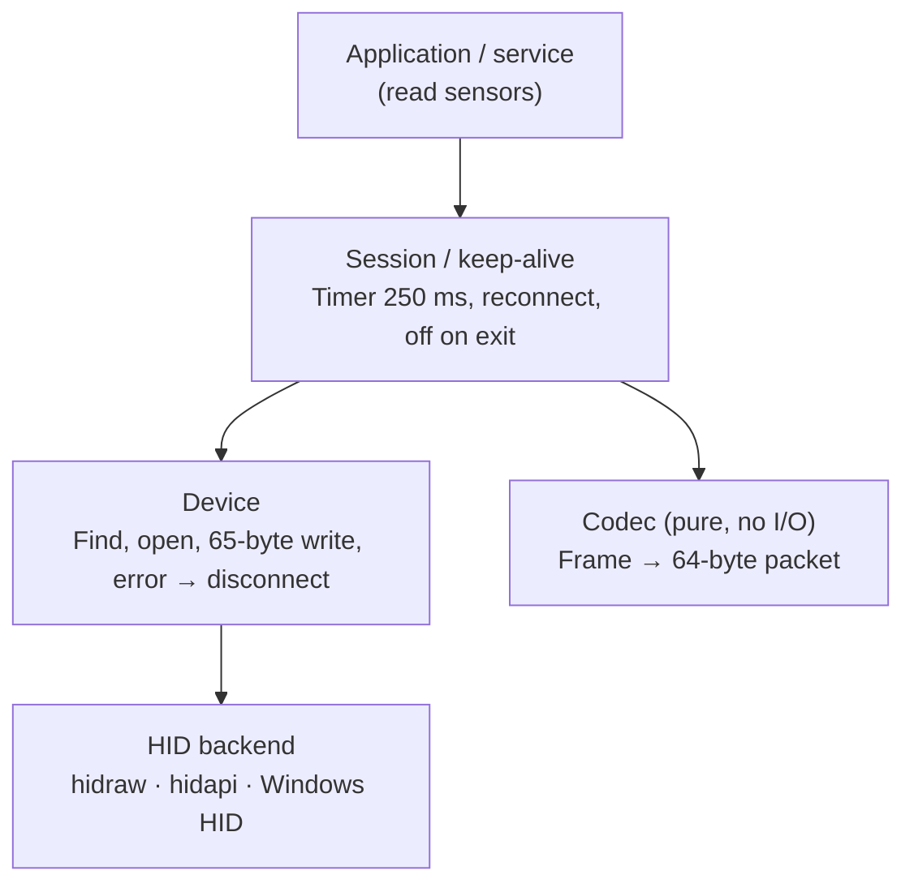

This page summarizes what a library for driving the display must provide – independent of
the programming language. The [.NET reference implementation](dotnet-reference/) implements it.

## Layers



| Layer | Responsibility | Testability |
|---|---|---|
| **Codec** | values → 64 bytes per [update packet](../protocol/update-packet/), off packet | fully unit-testable with the test vectors |
| **Device** | VID/PID search, opening, prepending the report ID, write with timeout | against real device / mock |
| **Session** | periodic sending, atomic swap of the current frame, hotplug | with fake device |

## Requirements

### Detection

- Only address **known VID/PID pairs** (`5131:200e`, `5131:2007`). Vendor `0x5131` is also used for
  unrelated devices – never write to "all devices of 0x5131".
- Additionally check: HID interface with output report length 64 (or 65 including report ID).
- No serial number available → distinguish multiple devices by their physical path.
- Missing product/manufacturer strings are **not an error**.

### Sending

- Send every packet **completely** (64 bytes); via hidraw/hidapi/Windows with report ID `0x00` prepended (65 bytes).
- Interval **250 ms** by default, configurable, but **at most 400 ms** – the display turns off after approx. 400–500 ms without a packet.
- The sending thread must not be blocked by slow sensors: read sensors at their own pace
  and place the last valid frame into the session **atomically**.
- **One** writer per device (mutex or similar). Two processes on the same device cause flickering.
- Fill the time fields with the current local time in every packet.

### Errors & hotplug

| Situation | Behavior |
|---|---|
| Device not present at startup | rescan periodically (e.g. every second) or use a udev monitor |
| Opening fails with "access denied" | clear message pointing to the udev rule; do not log in an endless loop |
| Write fails (`ENODEV`, `EPIPE`, I/O error) | close handle, state "disconnected", reconnect |
| Write timeout | retry once, then treat as an error |
| Exit (Dispose, `SIGTERM`, service stop) | stop timer, send **off packet**, close handle |
| System suspend | reconnect after resume (device is often re-enumerated) |

### Recommended API

```text
Frame            – immutable set of values (nullable fields, temperatures always in °C, unit separate)
encode_update(frame, now) -> bytes[64]
encode_off()              -> bytes[64]
enumerate()               -> [DeviceInfo]        # without opening (works without permissions)
open(info)                -> Device
Device.send_packet(bytes[64])
Session(connect_fn, interval)
Session.update(frame)       # thread-safe
Session.start() / Session.close(send_off = true)
events: connected(path), disconnected, packet_sent(bytes)
```

### Non-goals

- **Controlling** fan/pump (handled via the motherboard headers).
- ARGB lighting (handled via the 5 V ARGB header).
- Sensors in the library itself – better as a plug-in/callback so that the library stays platform-neutral.

## Platform backends

| Platform | Backend | Notes |
|---|---|---|
| Linux | hidraw directly (`open`/`write`/`poll`) | no dependencies, [details](../linux/hidraw/) |
| Linux / Windows / macOS | hidapi (`libhidapi-hidraw`, `hidapi.dll`) | native library required |
| .NET | **HidApi.Net** (AOT-capable binding for hidapi) | used in the reference, requires native hidapi |
| .NET | HidSharp (fully managed, Linux via hidraw + libudev) | no native dependencies, but trim warning under AOT |
| Windows native | `CreateFile` on interface path, `WriteFile` with 65 bytes | path via SetupAPI/`HidD_GetHidGuid` |
| Any | libusb (interrupt OUT on EP `0x01`, **64** bytes without report ID) | kernel driver must be detached – not recommended |
