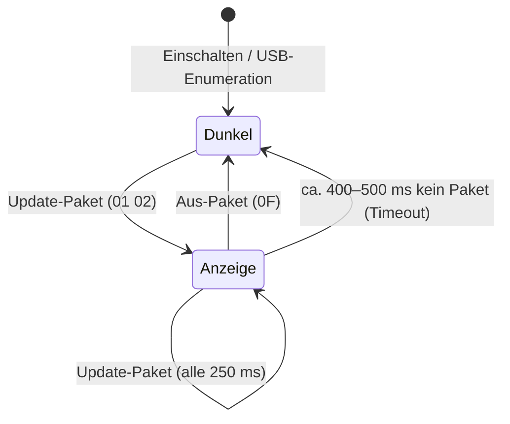

Das Display ist ein „dummes“ Anzeigegerät: Es misst nichts selbst, sondern zeigt nur, was der Host
schickt. Der Host muss die Werte **periodisch** senden, sonst schaltet sich das Display ab.


Die Paketstruktur stammt aus der Analyse der LA-Serie (`5131:2007`) durch ThermalTakeWaKue. Für die
LB360-S (`5131:200e`) ist das Update-Paket auf Hardware bestätigt; welche Felder sie anzeigt, steht unter
[Verifikation](verification/).


## Transport

| Eigenschaft | Wert |
|---|---|
| Schnittstelle | USB HID, Interface 0, Vendor-Usage-Page `0xFF00`, Usage `0x01` |
| Richtung Host → Gerät | **Output-Report**, 64 Byte, über Interrupt-OUT-Endpoint `0x01` |
| Richtung Gerät → Host | Input-Report, 64 Byte, über Interrupt-IN-Endpoint `0x81` (Bedeutung unbekannt, [siehe hier](input-reports/)) |
| Report-IDs | **keine** |
| Feature-Reports | keine |
| Initialisierung | **keine** nötig – das erste Update-Paket wird direkt angezeigt |
| Byte-Reihenfolge | nicht relevant: alle Werte sind einzelne Bytes (vorzeichenlos, `0–255`) |

### Report-ID-Byte beim Schreiben

Weil der Deskriptor keine Report-IDs definiert, ist ein Report auf der Leitung **genau 64 Byte** lang.
Alle gängigen HID-APIs erwarten beim Schreiben aber ein vorangestelltes Report-ID-Byte, das bei
unnummerierten Reports `0x00` sein muss:

| API | Puffer beim Schreiben | Was auf die Leitung geht |
|---|---|---|
| Linux hidraw `write()` | 65 Byte: `00` + 64 Byte Paket | 64 Byte (usbhid entfernt das `00`) |
| hidapi `hid_write()` | 65 Byte: `00` + Paket | 64 Byte |
| Windows `WriteFile` / `HidD_SetOutputReport` | exakt `OutputReportByteLength` = 65 Byte | 64 Byte |
| HidSharp `HidStream.Write` / HidApi.Net `Device.Write` | 65 Byte | 64 Byte |
| libusb direkt (Interrupt-Transfer auf EP `0x01`) | 64 Byte Paket, **ohne** Report-ID | 64 Byte |


**Häufigster Fehler:** Das **Paket selbst beginnt ebenfalls mit `0x00`** (Byte 0 ist reserviert).
Beim Schreiben über hidraw/hidapi steht also *zweimal* `00` am Anfang: `00 | 00 01 02 …`.
Wer das Report-ID-Byte vergisst, verschiebt alle Felder um eine Stelle – das Display zeigt dann
Unsinn oder nichts.


In dieser Dokumentation bezeichnet **„Paket“** immer die 64 Byte auf der Leitung (Offsets 0–63),
**ohne** Report-ID-Byte.

### Timing

| Parameter | Wert | Quelle |
|---|---|---|
| Sendeintervall der Original-Software | **250 ms** (LA) bzw. **~200–220 ms** (LB360-S, TT SEGMENT LCD Software) | Mitschnitte |
| Timeout bis Display aus | LB360-S: **sehr kurz** (subjektiv sofort, < 1 s) nach dem letzten Paket – unabhängig davon, ob das Gerät geöffnet bleibt | `seglcd hold` |
| Maximales Intervall | **400 ms** (LB360-S); Standard 250 ms lässt ~150–250 ms Reserve | Messung |
| Minimales Intervall | nicht bekannt; Endpoint-Polling 1 ms, empfohlen ≥ 100 ms | Deskriptor |

Empfehlung für Implementierungen: **250 ms wie das Original.** Die LB360-S schaltet das Display etwa
400–500 ms nach dem letzten Paket ab – auch wenn das Gerät geöffnet bleibt. Mehr als 400 ms Abstand zwischen
zwei Paketen führt zu sichtbarem Flackern. Der Sende-Takt muss
deshalb unabhängig von langsamen Sensorabfragen laufen (eigener Timer, letzter Frame wird wiederholt);
Aussetzer durch blockierende Sensor-Reads oder lange GC-Pausen führen sonst zu sichtbarem Flackern.

## Pakettypen

| Byte 1 | Byte 2 | Name | Beschreibung |
|---|---|---|---|
| `0x01` | `0x02` | [Update](update-packet/) | Alle Messwerte und Uhrzeit; wird periodisch gesendet |
| `0x0F` | `0x00` | [Aus](off-packet/) | Display dunkel schalten (Original-Software beim Beenden) |

Byte 0 ist in allen bekannten Paketen `0x00`. Andere Kommandowerte sind nicht bekannt; eine Library
sollte keine anderen senden. Mit `seglcd raw` lassen sich unbekannte Kommandos gezielt ausprobieren.

## Zustandsmodell des Geräts

Es gibt keinen bekannten Zustand, der im Gerät gespeichert bleibt (keine Konfiguration, kein Modus).
Jedes Update-Paket ist vollständig und unabhängig von den vorherigen.
