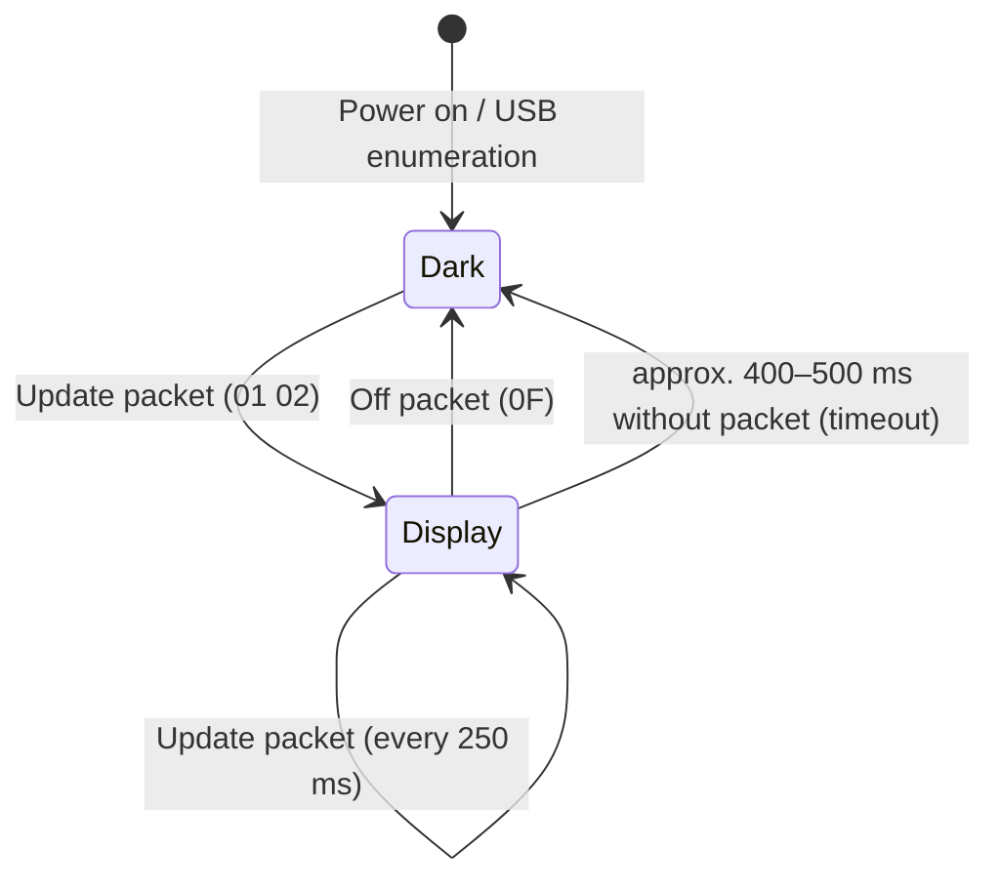

The display is a "dumb" output device: it measures nothing itself and only shows what the host
sends. The host must send the values **periodically**, otherwise the display turns off.


The packet structure comes from ThermalTakeWaKue's analysis of the LA series (`5131:2007`). For the
LB360-S (`5131:200e`) the update packet is confirmed on hardware; which fields it displays is described under
[Verification](verification/).


## Transport

| Property | Value |
|---|---|
| Interface | USB HID, interface 0, vendor usage page `0xFF00`, usage `0x01` |
| Direction host → device | **Output report**, 64 bytes, via interrupt OUT endpoint `0x01` |
| Direction device → host | Input report, 64 bytes, via interrupt IN endpoint `0x81` (meaning unknown, [see here](input-reports/)) |
| Report IDs | **none** |
| Feature reports | none |
| Initialization | **none** required – the first update packet is displayed immediately |
| Byte order | not relevant: all values are single bytes (unsigned, `0–255`) |

### Report ID byte when writing

Because the descriptor defines no report IDs, a report on the wire is **exactly 64 bytes** long.
However, all common HID APIs expect a leading report ID byte when writing, which must be
`0x00` for unnumbered reports:

| API | Buffer when writing | What goes on the wire |
|---|---|---|
| Linux hidraw `write()` | 65 bytes: `00` + 64-byte packet | 64 bytes (usbhid strips the `00`) |
| hidapi `hid_write()` | 65 bytes: `00` + packet | 64 bytes |
| Windows `WriteFile` / `HidD_SetOutputReport` | exactly `OutputReportByteLength` = 65 bytes | 64 bytes |
| HidSharp `HidStream.Write` / HidApi.Net `Device.Write` | 65 bytes | 64 bytes |
| libusb directly (interrupt transfer on EP `0x01`) | 64-byte packet, **without** report ID | 64 bytes |


**Most common mistake:** The **packet itself also starts with `0x00`** (byte 0 is reserved).
When writing via hidraw/hidapi, the buffer therefore starts with `00` *twice*: `00 | 00 01 02 …`.
Forgetting the report ID byte shifts all fields by one position – the display then shows
garbage or nothing.


In this documentation, **"packet"** always refers to the 64 bytes on the wire (offsets 0–63),
**without** the report ID byte.

### Timing

| Parameter | Value | Source |
|---|---|---|
| Update interval of the original software | **250 ms** (LA) or **~200–220 ms** (LB360-S, TT SEGMENT LCD Software) | captures |
| Timeout until display off | LB360-S: **very short** (subjectively immediate, < 1 s) after the last packet – regardless of whether the device stays open | `seglcd hold` |
| Maximum interval | **400 ms** (LB360-S); the default of 250 ms leaves ~150–250 ms of headroom | measurement |
| Minimum interval | unknown; endpoint polling 1 ms, recommended ≥ 100 ms | descriptor |

Recommendation for implementations: **250 ms, like the original.** The LB360-S turns the display off about
400–500 ms after the last packet – even if the device stays open. More than 400 ms between
two packets leads to visible flickering. The send clock must
therefore run independently of slow sensor queries (separate timer, last frame is repeated);
otherwise, dropouts caused by blocking sensor reads or long GC pauses lead to visible flickering.

## Packet types

| Byte 1 | Byte 2 | Name | Description |
|---|---|---|---|
| `0x01` | `0x02` | [Update](update-packet/) | All readings and the time; sent periodically |
| `0x0F` | `0x00` | [Off](off-packet/) | Turn the display dark (original software on exit) |

Byte 0 is `0x00` in all known packets. No other command values are known; a library
should not send any others. `seglcd raw` can be used to try out unknown commands in a targeted way.

## Device state model

There is no known state that persists in the device (no configuration, no mode).
Every update packet is complete and independent of the previous ones.
