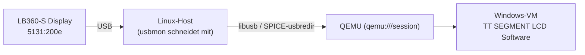

Um die restlichen offenen Fragen zur LB360-S zu klären (Timeout, Aus-Paket, mögliche weitere Kommandos), wird der USB-Verkehr der **originalen Windows-Software**
mitgeschnitten. Dafür muss kein Windows auf echter Hardware laufen: das Display wird per USB-Passthrough an
eine Windows-VM durchgereicht und der Verkehr **auf dem Linux-Host** mit `usbmon` aufgezeichnet.


  
  

