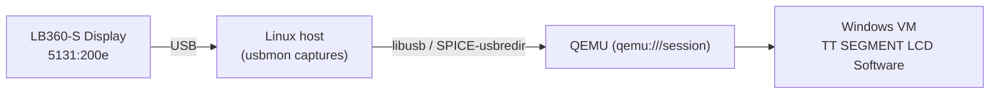

To resolve the remaining open questions about the LB360-S (timeout, off packet, possible further commands), the USB traffic of the **original Windows software**
is captured. This does not require Windows on real hardware: the display is passed through to
a Windows VM via USB passthrough, and the traffic is recorded **on the Linux host** with `usbmon`.


  
  

