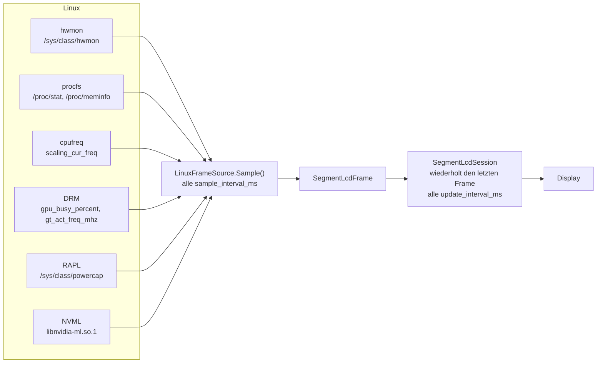

Diese Seite beschreibt, **woher** `seglcd live` und der Dienst [`seglcdd`](../service/) ihre Messwerte holen,
**wie** sie umgerechnet werden und **wie** man die Quellen konfiguriert. Der Code dazu liegt in der Library
`src/SegLcd.Linux` (`LinuxSensors`, `LinuxFrameSource`) und wird von CLI und Dienst gemeinsam
genutzt – beide verhalten sich daher identisch.


Die LB360-S **zeigt nur CPU- und GPU-Temperatur** an (ganzzahlig, °C, max. 99). Alle anderen Werte werden
trotzdem wie von der Original-Software mitgesendet, haben auf diesem Modell aber keine sichtbare Wirkung.


## Ablauf



Es gibt **zwei unabhängige Takte**:

| Takt | Standard | Zweck |
|---|---|---|
| `sample_interval_ms` (CLI: `--sample-interval`) | 1000 ms | Sensoren neu einlesen. Langsame Sensoren bremsen so nie das Senden. |
| `update_interval_ms` (CLI: `--interval`) | 250 ms | Pakete senden; der letzte Frame wird wiederholt. **Max. 400 ms**, sonst schaltet das Display ab ([Timeout](../protocol/verification/)). |

## Woher die Werte kommen

| Feld | Quelle | Rohformat → Einheit | Standard (Reihenfolge) |
|---|---|---|---|
| CPU-Temperatur | hwmon `temp*_input` | m°C → °C | `k10temp:Tctl`, `zenpower:Tdie`, `zenpower:Tctl`, `coretemp:Package id 0` |
| CPU-Auslastung | `/proc/stat`, Zeile `cpu` | Differenz zweier Messungen: `100 × (1 − Δ(idle+iowait) / Δgesamt)` | fest |
| CPU-Leistung | RAPL `/sys/class/powercap/intel-rapl:0/energy_uj` **oder** hwmon `power*_input` | µJ-Zähler → W (Δ Energie / Δ Zeit, Überlauf über `max_energy_range_uj`); µW → W | `rapl`, `zenpower:SVI2_P_Core+zenpower:SVI2_P_SoC` |
| CPU-Takt | `/sys/devices/system/cpu/cpu*/cpufreq/scaling_cur_freq` | kHz → MHz, über alle Kerne zusammengefasst | Durchschnitt (`cpu_clock_mode`) |
| CPU-Spannung | hwmon `in*_input` | mV → V | `zenpower:SVI2_Core` |
| GPU-Temperatur | hwmon `temp*_input` **oder** NVML | m°C → °C | `amdgpu:edge`, `nvml:temperature`, `xe:pkg` |
| GPU-Auslastung | DRM `device/gpu_busy_percent` **oder** NVML | % | `drm:busy`, `nvml:usage` |
| GPU-Leistung | hwmon `power*_input`/`power*_average`, NVML **oder** RAPL `uncore` | µW → W, mW → W | `amdgpu:PPT`, `nvml:power`, `rapl:uncore` |
| GPU-Takt | hwmon `freq*_input`, NVML **oder** DRM-Frequenz | Hz → MHz | `amdgpu:sclk`, `nvml:clock`, `drm:freq` |
| Lüfter | hwmon `fan*_input` | RPM | **keiner** – Header ist boardabhängig |
| Pumpe | hwmon `fan*_input` | RPM | **keiner** – Header ist boardabhängig |
| RAM-Auslastung | `/proc/meminfo` | `(MemTotal − MemAvailable) / MemTotal` in % | fest |
| Uhrzeit | Systemzeit (lokal) | – | fest |

Ein Wert, für den keine Quelle gefunden wird oder der nicht lesbar ist, wird als `0` gesendet
(bzw. als „–“ angezeigt). Die erste CPU-Auslastung und die erste RAPL-Leistung nach dem Start fehlen,
weil beide eine Differenz zweier Messungen brauchen.

### Hinweise zu einzelnen Treibern

- **k10temp vs. zenpower (AMD):** k10temp ist der Standardtreiber und liefert `Tctl` (bei manchen älteren
  Ryzen mit festem Offset) und `Tccd*`, aber **keine Leistung und keine Spannung**. zenpower (Zusatzmodul)
  liefert zusätzlich SVI2-Spannungen, -Ströme und -Leistungen. Mit k10temp kommt die CPU-Leistung daher nur
  über RAPL.
- **RAPL** ist die genaue **Paketleistung** (das, was z. B. btop anzeigt). Seit Linux 5.10 ist der Zähler nur
  für root lesbar ([PLATYPUS, CVE-2020-8694](https://platypusattack.com/)). Möglichkeiten:
  - optional die udev-Regel [`udev/72-rapl-energy-read.rules`](../linux/udev/#optional-rapl-für-die-cpu-leistung)
    installieren – öffnet den Zähler nur für die Gruppe `rapl`;
  - oder ohne RAPL leben: zenpower Core + SoC ist eine gute Näherung (etwas niedriger, ohne I/O-Die),
    mit k10temp bleibt die Leistung leer.

  btop löst das mit der Capability `cap_dac_read_search`, die **jede** Datei lesbar macht – für
  `seglcd`/`seglcdd` nicht empfohlen.
- **Intel-CPU:** `coretemp:Package id 0` für die Temperatur, RAPL (`rapl`) für die Paketleistung, `rapl:core`
  für die Kerne. Eine Kernspannung liefert coretemp nicht.
- **Intel-GPU:**
  - *integriert (i915/xe):* Takt über `drm:freq` (`gt_act_freq_mhz` bzw. `tile0/gt0/freq0/act_freq`),
    Leistung über `rapl:uncore` (RAPL-Domäne der Grafik). Temperatur und Auslastung stellt der Treiber nicht
    über sysfs bereit.
  - *diskret (Arc mit xe):* zusätzlich Temperatur über xe-hwmon (`xe:pkg`, je nach Kernel); bei i915 keine Temperatur.
- **NVIDIA:** Die Werte kommen über **NVML** (`libnvidia-ml.so.1`, gehört zum Treiber – proprietär wie offen).
  Die Bibliothek wird zur Laufzeit geladen; ohne NVIDIA-Treiber sind die `nvml:`-Angaben einfach nicht vorhanden.
  NVML liefert die Lüfterdrehzahl nur in Prozent (`nvml:fan`), nicht in RPM.
- **Hybrid-Systeme** (z. B. Laptop mit Intel-iGPU und NVIDIA-dGPU): Es gilt die erste passende Quelle der
  Standard-Reihenfolge – im Zweifel die gewünschte GPU explizit konfigurieren (`nvml1:…`, `drm0:freq`).


NVIDIA- und Intel-Unterstützung sind nach Dokumentation der Treiber-Schnittstellen implementiert, aber **noch
nicht auf echter Hardware getestet** (Referenzsystem: AMD-CPU und -GPU). Rückmeldungen mit `seglcd sensors` sind
willkommen.


## Sensor-Angaben (Spec-Syntax)

Überall dort, wo eine Quelle angegeben werden kann – CLI-Option, `config.toml`, D-Bus `SetSensor` –
gilt dieselbe Syntax:

| Form | Beispiel | Bedeutung |
|---|---|---|
| `hwmonN/name` | `hwmon5/fan1` | direkter Pfad unter `/sys/class/hwmon`. **Nummer kann sich beim Neustart ändern.** |
| `chip:label` | `k10temp:Tctl`, `it8686_31050607:fan5` | Chipname (`name`) und Label (`*_label`, sonst der Dateiname wie `fan5`). **Stabil – bevorzugen.** |
| `a+b` | `zenpower:SVI2_P_Core+zenpower:SVI2_P_SoC` | Summe mehrerer Sensoren (leer, wenn einer fehlt) |
| `rapl`, `rapl:<domäne>` | `rapl`, `rapl:core`, `rapl:uncore` | Leistung aus einem RAPL-Zähler (`package` = Standard, `core`, `uncore`, `dram`, `psys`) |
| `nvml[N]:<wert>` | `nvml:temperature`, `nvml1:power` | NVIDIA-GPU N (Standard 0): `temperature`, `power`, `clock`, `memclock`, `usage`, `fan` (%) |
| `drm[N]:<wert>` | `drm:busy`, `drm0:freq` | DRM-Karte N (Standard: erste passende): `busy` (%), `freq` (MHz, Intel) |
| leer | `""` | automatische Auswahl nach der Standard-Reihenfolge oben |

Groß-/Kleinschreibung spielt keine Rolle. Ein Chipname wie `it8686_31050607` enthält die I/O-Adresse des
Super-I/O-Chips; er ist auf demselben Board stabil.

### Verfügbare Sensoren finden

```fish
seglcd sensors
```

Die Ausgabe ist nach Quellenart gruppiert; die erste Spalte ist direkt als Spec verwendbar:

```text
# hwmon (Spec: hwmonN/name oder chip:label)
amdgpu:edge                                   47  hwmon3/temp1
amdgpu:PPT                                    26  hwmon3/power1
k10temp:Tctl                              56.375  hwmon4/temp1
it8686_31050607:fan1                        1022  hwmon5/fan1
it8686_31050607:fan5                        2947  hwmon5/fan5

# RAPL (Spec: rapl, rapl:<domäne>) – W, gemessen über 0,5 s
rapl:package                            (Rechte)  /sys/class/powercap/intel-rapl:0

# NVIDIA NVML (Spec: nvml[N]:temperature|power|clock|memclock|usage|fan)
(keine NVIDIA-GPU bzw. libnvidia-ml.so.1 nicht gefunden)

# DRM (Spec: drm[N]:busy|freq)
drm1:busy                                      5  DRM card1 busy (/sys/class/drm/card1/device/gpu_busy_percent)

# fest eingebaut
(cpufreq) CPU-Takt MHz       3219/1755/4450/3559  avg/min/max/cpu0
(meminfo) RAM %                           41.427  /proc/meminfo
```

„(Rechte)“ bedeutet: Domäne vorhanden, aber `energy_uj` nicht lesbar (siehe RAPL oben).

### Lüfter und Pumpe zuordnen

Welcher `fanN`-Eingang zu welchem Mainboard-Header gehört, weiß nur das Board-Handbuch bzw. BIOS
(Bezeichnungen wie `CPU_FAN`, `CPU_OPT`, `AIO_PUMP`, `SYS_FAN1`). Praktische Hinweise:

- Die **Pumpe** der LB360-S läuft fast konstant im Bereich um **3000 RPM**.
- Die **Radiatorlüfter** ändern ihre Drehzahl mit der CPU-Last; laufen drei Lüfter über einen Splitter,
  meldet nur einer seine Drehzahl.
- Gegenprobe: im BIOS bzw. per Lüfterkurve einen Header kurz hochdrehen und in `seglcd sensors` beobachten.

## Konfiguration

Die Quellen lassen sich an drei Stellen setzen – mit denselben Spec-Angaben:

| Feld | `seglcd live`-Option | `config.toml` (`[sensors]`) | D-Bus `SetSensor(field, …)` |
|---|---|---|---|
| CPU-Temperatur | `--cpu-temp-sensor` | `cpu_temperature` | `cpu_temperature` |
| CPU-Leistung | `--cpu-power-sensor` | `cpu_power` | `cpu_power` |
| CPU-Spannung | `--cpu-voltage-sensor` | `cpu_voltage` | `cpu_voltage` |
| CPU-Takt (Modus) | `--cpu-clock-mode Avg\|Max\|Min\|First` | `cpu_clock_mode = "avg"` | – |
| GPU-Temperatur | `--gpu-temp-sensor` | `gpu_temperature` | `gpu_temperature` |
| GPU-Auslastung | `--gpu-usage-sensor` | `gpu_usage` | `gpu_usage` |
| GPU-Leistung | `--gpu-power-sensor` | `gpu_power` | `gpu_power` |
| GPU-Takt | `--gpu-clock-sensor` | `gpu_clock` | `gpu_clock` |
| Lüfter | `--fan-sensor` | `fan` | `fan` |
| Pumpe | `--pump-sensor` | `pump` | `pump` |
| Sendeintervall | `--interval` | `update_interval_ms` (oberste Ebene) | Property `UpdateIntervalMs` |
| Einleseintervall | `--sample-interval` | `sample_interval_ms` | Property `SampleIntervalMs` |

### `config.toml`

Der Dienst liest `$XDG_CONFIG_HOME/seglcd/config.toml` (meist `~/.config/seglcd/config.toml`), alternativ
`seglcdd --config <pfad>`. Fehlt die Datei, gelten die Standardwerte. Format: [TOML 1.1](https://toml.io/),
Schlüssel in snake_case. Vorlage: `packaging/config.example.toml`.

Vollständige Standardkonfiguration mit allen Optionen – identisch mit `packaging/config.example.toml`, die
`packaging/install-user.sh` beim ersten Installieren nach `~/.config/seglcd/config.toml` kopiert:



| Schlüssel | Typ | Standard | Gültig |
|---|---|---|---|
| `enabled` | bool | `true` | – |
| `update_interval_ms` | int | `250` | 50–400 |
| `sample_interval_ms` | int | `1000` | 100–10000 |
| `device` | string | leer = erstes gefundenes Display | Pfad wie `/dev/hidraw5` |
| `sensors.*` | string | leer = automatisch | Spec-Syntax oben |
| `sensors.cpu_clock_mode` | string | `"avg"` | `avg`, `max`, `min`, `first` |

Ungültige Werte (Bereich, Syntax, unbekannter Modus) führen beim Start zu einer Fehlermeldung im Journal;
der Dienst läuft dann mit Standardwerten weiter. Beim `ReloadConfig` über D-Bus wird der Fehler als
D-Bus-Fehler zurückgegeben und die alte Konfiguration bleibt aktiv. Ein über D-Bus gesetzter Sensor, der
nicht existiert, wird abgelehnt.

### Empfohlenes Vorgehen

{}

### Sensoren ansehen

`seglcd sensors` – Chipnamen/Labels notieren, Lüfter- und Pumpen-Header bestimmen.

### Mit `live` ausprobieren

```fish
seglcd live --show --fan-sensor it8686_31050607:fan1 --pump-sensor it8686_31050607:fan5
```

Beim Start zeigt `live` für jedes Feld die gewählte Quelle; mit `--show` werden die Werte fortlaufend ausgegeben.

### In `config.toml` übernehmen

Dieselben Angaben unter `[sensors]` eintragen.

### Dienst (neu) laden

```fish
systemctl --user reload seglcdd   # oder: restart
journalctl --user -u seglcdd -n 20
```

Der Dienst protokolliert beim Start jede Quelle („Quelle fan: hwmon5/fan1 (it8686_31050607:fan1)“).

{}
