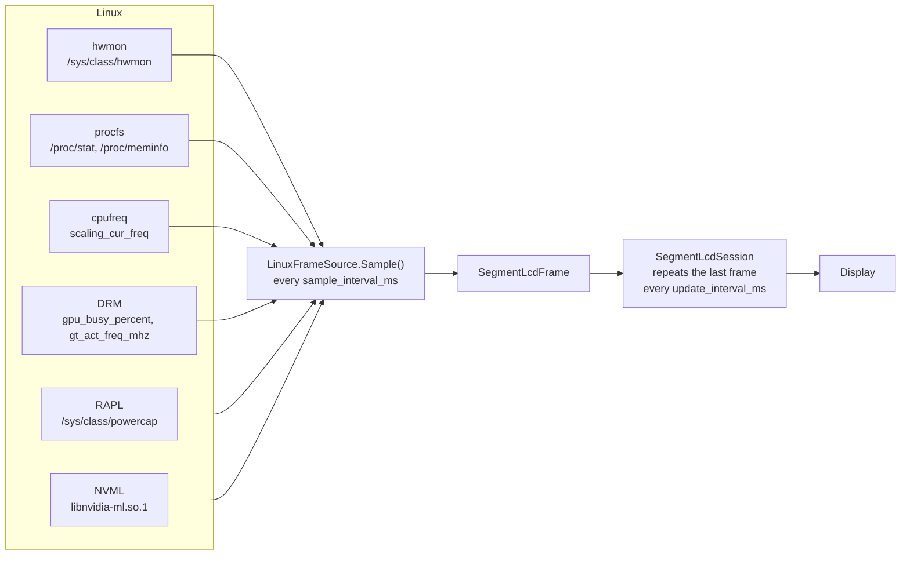

This page describes **where** `seglcd live` and the service [`seglcdd`](../service/) get their readings from,
**how** they are converted and **how** to configure the sources. The code lives in the library
`src/SegLcd.Linux` (`LinuxSensors`, `LinuxFrameSource`) and is shared by the CLI and the service
– so both behave identically.


The LB360-S **only shows CPU and GPU temperature** (integer, °C, max. 99). All other values are
still sent along like the original software does, but have no visible effect on this model.


## Flow



There are **two independent clocks**:

| Clock | Default | Purpose |
|---|---|---|
| `sample_interval_ms` (CLI: `--sample-interval`) | 1000 ms | Re-read sensors. This way slow sensors never hold up sending. |
| `update_interval_ms` (CLI: `--interval`) | 250 ms | Send packets; the last frame is repeated. **Max. 400 ms**, otherwise the display switches off ([timeout](../protocol/verification/)). |

## Where the values come from

| Field | Source | Raw format → unit | Default (order) |
|---|---|---|---|
| CPU temperature | hwmon `temp*_input` | m°C → °C | `k10temp:Tctl`, `zenpower:Tdie`, `zenpower:Tctl`, `coretemp:Package id 0` |
| CPU usage | `/proc/stat`, line `cpu` | difference of two measurements: `100 × (1 − Δ(idle+iowait) / Δtotal)` | fixed |
| CPU power | RAPL `/sys/class/powercap/intel-rapl:0/energy_uj` **or** hwmon `power*_input` | µJ counter → W (Δ energy / Δ time, overflow via `max_energy_range_uj`); µW → W | `rapl`, `zenpower:SVI2_P_Core+zenpower:SVI2_P_SoC` |
| CPU clock | `/sys/devices/system/cpu/cpu*/cpufreq/scaling_cur_freq` | kHz → MHz, aggregated over all cores | average (`cpu_clock_mode`) |
| CPU voltage | hwmon `in*_input` | mV → V | `zenpower:SVI2_Core` |
| GPU temperature | hwmon `temp*_input` **or** NVML | m°C → °C | `amdgpu:edge`, `nvml:temperature`, `xe:pkg` |
| GPU usage | DRM `device/gpu_busy_percent` **or** NVML | % | `drm:busy`, `nvml:usage` |
| GPU power | hwmon `power*_input`/`power*_average`, NVML **or** RAPL `uncore` | µW → W, mW → W | `amdgpu:PPT`, `nvml:power`, `rapl:uncore` |
| GPU clock | hwmon `freq*_input`, NVML **or** DRM frequency | Hz → MHz | `amdgpu:sclk`, `nvml:clock`, `drm:freq` |
| Fan | hwmon `fan*_input` | RPM | **none** – header depends on the board |
| Pump | hwmon `fan*_input` | RPM | **none** – header depends on the board |
| RAM usage | `/proc/meminfo` | `(MemTotal − MemAvailable) / MemTotal` in % | fixed |
| Time of day | system time (local) | – | fixed |

A value for which no source is found or which cannot be read is sent as `0`
(or shown as "–"). The first CPU usage and the first RAPL power after startup are missing,
because both need the difference of two measurements.

### Notes on individual drivers

- **k10temp vs. zenpower (AMD):** k10temp is the default driver and provides `Tctl` (with a fixed offset on some older
  Ryzen) and `Tccd*`, but **no power and no voltage**. zenpower (add-on module)
  additionally provides SVI2 voltages, currents and power. With k10temp, CPU power is therefore only available
  via RAPL.
- **RAPL** is the exact **package power** (what e.g. btop shows). Since Linux 5.10 the counter is only
  readable by root ([PLATYPUS, CVE-2020-8694](https://platypusattack.com/)). Options:
  - optionally install the udev rule [`udev/72-rapl-energy-read.rules`](../linux/udev/#optional-rapl-for-cpu-power)
    – it opens the counter only for the group `rapl`;
  - or live without RAPL: zenpower Core + SoC is a good approximation (somewhat lower, without the I/O die);
    with k10temp the power stays empty.

  btop solves this with the capability `cap_dac_read_search`, which makes **every** file readable – not recommended for
  `seglcd`/`seglcdd`.
- **Intel CPU:** `coretemp:Package id 0` for the temperature, RAPL (`rapl`) for the package power, `rapl:core`
  for the cores. coretemp does not provide a core voltage.
- **Intel GPU:**
  - *integrated (i915/xe):* clock via `drm:freq` (`gt_act_freq_mhz` or `tile0/gt0/freq0/act_freq`),
    power via `rapl:uncore` (RAPL domain of the graphics). The driver does not expose temperature and usage
    via sysfs.
  - *discrete (Arc with xe):* additionally temperature via xe-hwmon (`xe:pkg`, depending on the kernel); no temperature with i915.
- **NVIDIA:** The values come via **NVML** (`libnvidia-ml.so.1`, part of the driver – both proprietary and open).
  The library is loaded at runtime; without the NVIDIA driver the `nvml:` specs are simply not present.
  NVML only provides the fan speed in percent (`nvml:fan`), not in RPM.
- **Hybrid systems** (e.g. laptop with Intel iGPU and NVIDIA dGPU): the first matching source of the
  default order applies – if in doubt, configure the desired GPU explicitly (`nvml1:…`, `drm0:freq`).


NVIDIA and Intel support are implemented according to the documentation of the driver interfaces, but **not yet
tested on real hardware** (reference system: AMD CPU and GPU). Feedback with `seglcd sensors` is
welcome.


## Sensor specs (spec syntax)

Wherever a source can be specified – CLI option, `config.toml`, D-Bus `SetSensor` –
the same syntax applies:

| Form | Example | Meaning |
|---|---|---|
| `hwmonN/name` | `hwmon5/fan1` | direct path under `/sys/class/hwmon`. **The number can change on reboot.** |
| `chip:label` | `k10temp:Tctl`, `it8686_31050607:fan5` | chip name (`name`) and label (`*_label`, otherwise the file name such as `fan5`). **Stable – prefer this.** |
| `a+b` | `zenpower:SVI2_P_Core+zenpower:SVI2_P_SoC` | sum of several sensors (empty if one is missing) |
| `rapl`, `rapl:<domain>` | `rapl`, `rapl:core`, `rapl:uncore` | power from a RAPL counter (`package` = default, `core`, `uncore`, `dram`, `psys`) |
| `nvml[N]:<value>` | `nvml:temperature`, `nvml1:power` | NVIDIA GPU N (default 0): `temperature`, `power`, `clock`, `memclock`, `usage`, `fan` (%) |
| `drm[N]:<value>` | `drm:busy`, `drm0:freq` | DRM card N (default: first matching): `busy` (%), `freq` (MHz, Intel) |
| empty | `""` | automatic selection according to the default order above |

Case does not matter. A chip name such as `it8686_31050607` contains the I/O address of the
Super I/O chip; it is stable on the same board.

### Finding available sensors

```fish
seglcd sensors
```

The output is grouped by source type; the first column can be used directly as a sensor spec:

```text
# hwmon (spec: hwmonN/name or chip:label)
amdgpu:edge                                   47  hwmon3/temp1
amdgpu:PPT                                    26  hwmon3/power1
k10temp:Tctl                              56.375  hwmon4/temp1
it8686_31050607:fan1                        1022  hwmon5/fan1
it8686_31050607:fan5                        2947  hwmon5/fan5

# RAPL (spec: rapl, rapl:<domain>) – W, measured over 0.5 s
rapl:package                       (permissions)  /sys/class/powercap/intel-rapl:0

# NVIDIA NVML (spec: nvml[N]:temperature|power|clock|memclock|usage|fan)
(no NVIDIA GPU, or libnvidia-ml.so.1 not found)

# DRM (spec: drm[N]:busy|freq)
drm1:busy                                      5  DRM card1 busy (/sys/class/drm/card1/device/gpu_busy_percent)

# built in
(cpufreq) CPU clock MHz      3219/1755/4450/3559  avg/min/max/cpu0
(meminfo) RAM %                           41.427  /proc/meminfo
```

"(permissions)" means: the domain exists, but `energy_uj` is not readable (see RAPL above).

### Assigning fan and pump

Which `fanN` input belongs to which mainboard header is only known from the board manual or BIOS
(labels such as `CPU_FAN`, `CPU_OPT`, `AIO_PUMP`, `SYS_FAN1`). Practical hints:

- The **pump** of the LB360-S runs almost constantly at around **3000 RPM**.
- The **radiator fans** change their speed with CPU load; if three fans run via a splitter,
  only one reports its speed.
- Cross-check: briefly spin up a header in the BIOS or via a fan curve and watch it in `seglcd sensors`.

## Configuration

The sources can be set in three places – with the same sensor specs:

| Field | `seglcd live` option | `config.toml` (`[sensors]`) | D-Bus `SetSensor(field, …)` |
|---|---|---|---|
| CPU temperature | `--cpu-temp-sensor` | `cpu_temperature` | `cpu_temperature` |
| CPU power | `--cpu-power-sensor` | `cpu_power` | `cpu_power` |
| CPU voltage | `--cpu-voltage-sensor` | `cpu_voltage` | `cpu_voltage` |
| CPU clock (mode) | `--cpu-clock-mode Avg\|Max\|Min\|First` | `cpu_clock_mode = "avg"` | – |
| GPU temperature | `--gpu-temp-sensor` | `gpu_temperature` | `gpu_temperature` |
| GPU usage | `--gpu-usage-sensor` | `gpu_usage` | `gpu_usage` |
| GPU power | `--gpu-power-sensor` | `gpu_power` | `gpu_power` |
| GPU clock | `--gpu-clock-sensor` | `gpu_clock` | `gpu_clock` |
| Fan | `--fan-sensor` | `fan` | `fan` |
| Pump | `--pump-sensor` | `pump` | `pump` |
| Update interval | `--interval` | `update_interval_ms` (top level) | property `UpdateIntervalMs` |
| Sample interval | `--sample-interval` | `sample_interval_ms` | property `SampleIntervalMs` |

### `config.toml`

The service reads `$XDG_CONFIG_HOME/seglcd/config.toml` (usually `~/.config/seglcd/config.toml`), alternatively
`seglcdd --config <path>`. If the file is missing, the default values apply. Format: [TOML 1.1](https://toml.io/),
keys in snake_case. Template: `packaging/config.example.toml`.

Complete default configuration with all options – identical to `packaging/config.example.toml`, which
`packaging/install-user.sh` copies to `~/.config/seglcd/config.toml` on the first installation:



| Key | Type | Default | Valid |
|---|---|---|---|
| `enabled` | bool | `true` | – |
| `update_interval_ms` | int | `250` | 50–400 |
| `sample_interval_ms` | int | `1000` | 100–10000 |
| `device` | string | empty = first display found | path such as `/dev/hidraw5` |
| `sensors.*` | string | empty = automatic | spec syntax above |
| `sensors.cpu_clock_mode` | string | `"avg"` | `avg`, `max`, `min`, `first` |

Invalid values (range, syntax, unknown mode) lead to an error message in the journal at startup;
the service then continues with default values. With `ReloadConfig` via D-Bus, the error is returned as a
D-Bus error and the old configuration remains active. A sensor set via D-Bus that
does not exist is rejected.

### Recommended procedure

{}

### Inspect sensors

`seglcd sensors` – note chip names/labels, determine the fan and pump headers.

### Try it with `live`

```fish
seglcd live --show --fan-sensor it8686_31050607:fan1 --pump-sensor it8686_31050607:fan5
```

On startup, `live` shows the selected source for each field; with `--show` the values are printed continuously.

### Transfer to `config.toml`

Enter the same specs under `[sensors]`.

### (Re)load the service

```fish
systemctl --user reload seglcdd   # or: restart
journalctl --user -u seglcdd -n 20
```

The service logs each source at startup ("Source fan: hwmon5/fan1 (it8686_31050607:fan1)").

{}
